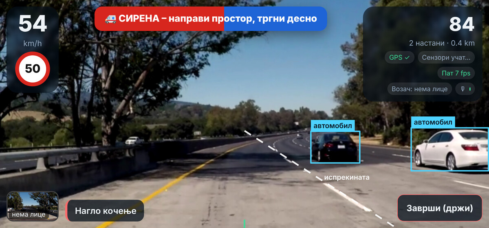
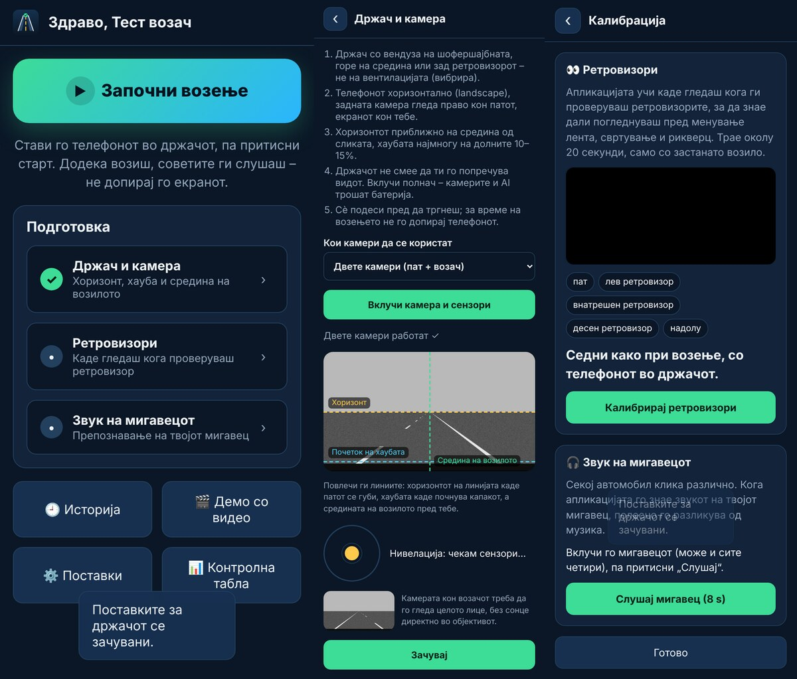
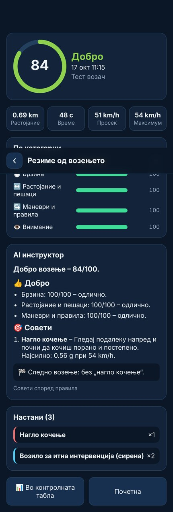
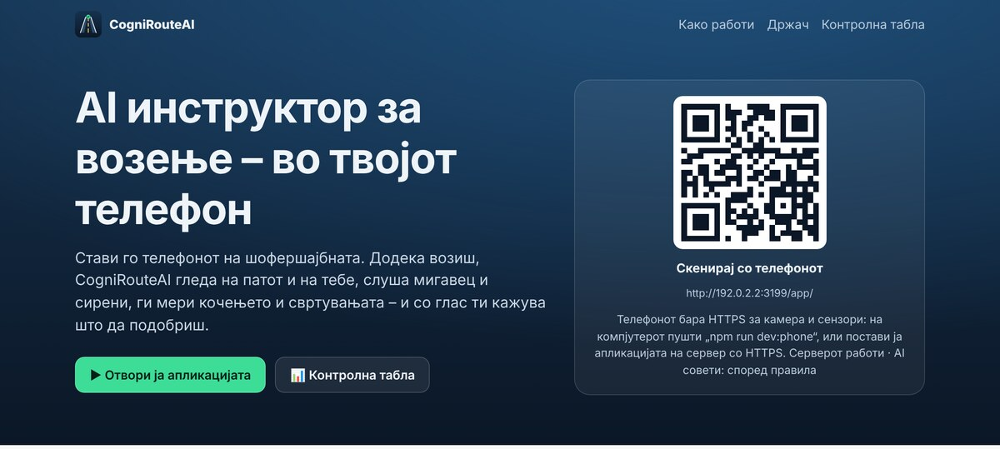
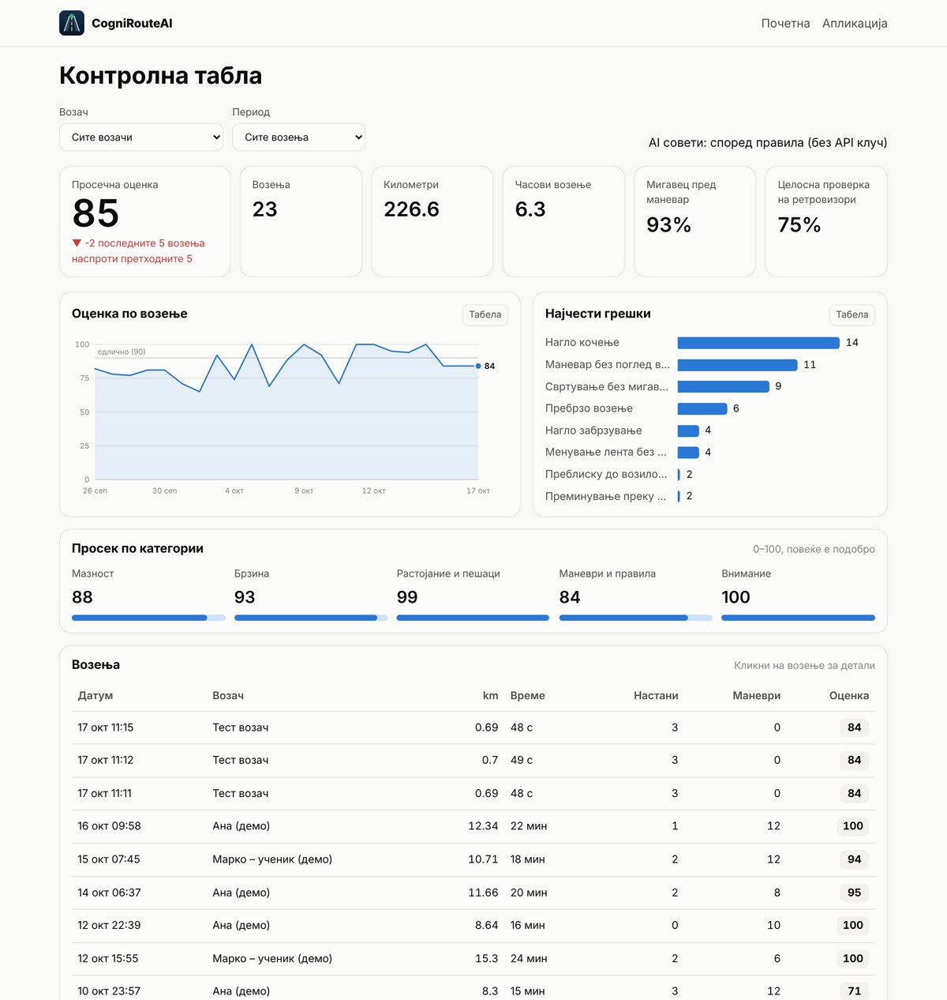

# CogniRouteAI

*AI driving coach: a phone app (PWA) that watches the road and the driver, listens for turn signals and sirens, reads the motion sensors while you drive, and gives spoken and written feedback, plus a web dashboard. Documentation below is in Macedonian.*

AI инструктор за возење на твојот телефон. Телефонот стои во држач на шофершајбната и додека возиш:

- **гледа на патот** (задна камера + YOLOv8): возила, пешаци, животни, знак STOP, полни и испрекинати линии, растојание до возилото напред;
- **гледа во тебе** (предна камера + MediaPipe): дали погледнуваш во ретровизор пред менување лента, свртување и рикверц, дали гледаш надолу, знаци на поспаност;
- **слуша** (микрофон): дали го вклучуваш мигавецот и дали се приближува брза помош, полиција или пожарна;
- **чувствува** (акцелерометар, жироскоп, GPS): нагло кочење и забрзување, остри кривини, свртувања, менување лента, рикверц, брзина и ограничувања;
- **зборува**: кратки гласовни предупредувања во реално време, а по возењето оценка и совети од AI инструктор (Claude).



| Мобилна апликација | Резиме и AI совети |
| --- | --- |
|  |  |

| Веб-страна | Контролна табла |
| --- | --- |
|  |  |

## Брз старт

Потребно: [Node.js](https://nodejs.org) 22.13 или понов.

```bash
npm install
npm run seed     # (по избор) демо возења за контролната табла
npm run dev      # API на :3000 + Vite на :5173
```

- Веб-страна: <http://localhost:5173/>
- Контролна табла: <http://localhost:5173/dashboard>
- Мобилна апликација: <http://localhost:5173/app/>

На компјутерот апликацијата работи со веб-камерата. Без автомобил пробај **„Демо со видео“**: избери видео снимено од автомобил (dashcam) и апликацијата го анализира како да е камерата кон патот, со симулирана брзина.

### На телефон

Камерата, микрофонот и сензорите во прелистувач работат само преку **HTTPS**.

1. **Ист Wi-Fi:** `npm run dev:phone`, па на телефонот отвори `https://<IP-на-компјутерот>:5173/app/` и прифати го предупредувањето за сертификатот. IP адресата ја гледаш во терминалот, а почетната страна покажува и QR код.
2. **Од каде било:** `npm run build && npm start`, па со тунел (на пр. `cloudflared tunnel --url http://localhost:3000`) добиваш HTTPS адреса. Отвори `<адреса>/app/`.
3. Во прелистувачот избери **„Додај на почетен екран“**: апликацијата се отвора на цел екран како вистинска апликација (PWA) и работи и без интернет; возењата се чуваат на телефонот и подоцна се испраќаат.

Пред првото возење: **Држач и камера** (хоризонт, хауба, средина на возилото), **Калибрација** на ретровизорите (20 секунди, застанат) и на звукот на мигавецот.

### AI совети со Claude

Копирај `.env.example` во `.env` и внеси `ANTHROPIC_API_KEY`. Серверот го користи моделот `claude-opus-5-5` (може да се смени со `ANTHROPIC_MODEL`) со структуриран излез: наслов, пофалби, совети и цел за следното возење. Вклучен е и server-side fallback: ако моделот одбие барање, API-то автоматски пробува резервен модел. Без клуч, и кога нема интернет, советите ги дава вграден систем со правила, во истата форма.

### Продукција

```bash
npm run build
npm start        # http://localhost:3000  (PORT, DB_FILE во .env)
```

Еден Node процес ги служи API-то, веб-страната и апликацијата. Може да се постави на Render, Railway, Fly.io или VPS. Потребен е трајен диск за SQLite базата (`DB_FILE`).

## Што и како препознава

| Што | Сензор | Како | Код |
| --- | --- | --- | --- |
| Положба на телефонот во колата | акцелерометар, жироскоп, GPS | гравитацијата дава „горе“; „напред“ се учи од промените на GPS брзината; знакот и единиците на жироскопот се проверуваат во свиоци | `shared/motion/calibration.js` |
| Нагло кочење, забрзување, остра кривина | акцелерометар | забрзување во правец на возилото > 0,35 g / 0,3 g / 0,4 g | `shared/motion/analyzer.js` |
| Свртување, менување лента | жироскоп + GPS | вртење ≥ 45°; кај лента два спротивни „бранови“ на вртење и ~3,5 m странично поместување | `shared/motion/yaw-maneuvers.js` |
| Рикверц | акцелерометар | од мирување, интегрирана брзина наназад | `shared/motion/analyzer.js` |
| Пребрзо | GPS + OpenStreetMap | ограничување од `maxspeed` (или 50/80/100/130 за МК) | `shared/speed-limits.js`, `shared/motion/speed.js` |
| Возила, пешаци, животни, STOP | задна камера | **YOLOv8n** (ONNX, onnxruntime-web, WebGPU или WebAssembly во Web Worker) | `shared/vision/yolo.js`, `mobile/src/vision/road.worker.js` |
| Растојание и правило на 2 секунди, судир | задна камера + GPS | растојание од големината на возилото и од допирот со патот; време до судир | `shared/vision/road-risk.js` |
| Полна / испрекината линија, менување лента | задна камера | светли тесни линии + Hough трансформација; колкав дел од линијата е обоен | `shared/vision/lanes.js` |
| Ретровизор пред маневар, поспаност, поглед надолу | предна камера | **MediaPipe Face Landmarker**: положба на главата и очите, калибрирани зони | `shared/gaze.js` |
| Редослед ретровизор → мигавец → маневар | сите | спојува маневри од жироскопот и камерата со погледите и мигавецот | `shared/maneuvers.js` |
| Мигавец | микрофон | кратки кликови во постојан ритам (60–120/мин) + шаблон од калибрацијата | `shared/audio/blinker.js` |
| Сирена | микрофон | силен тон што лизга (wail/yelp) или се менува меѓу два тона (hi-lo) | `shared/audio/siren.js` |
| Оценка и совети | — | казнени поени на 10 km по категории; Claude или правила | `shared/scoring.js`, `shared/coach.js`, `server/coach.js` |

## Структура

```
mobile/   мобилна апликација (PWA): екрани, сензори, камери, глас
web/      веб-страна (почетна) и контролна табла
shared/   целата логика за препознавање и оценување (без DOM, се тестира во Node)
server/   Express API, SQLite (node:sqlite), AI советник, демо податоци
public/   модели (yolov8n.onnx, face_landmarker.task), икони, service worker
ml/       Python: извоз на YOLOv8 во ONNX, тренирање YOLOv8 за линии на патот
test/     unit тестови (симулирани возења, звук, сцени од пат) и e2e тест во Chromium
```

## Тестови

```bash
npm test                          # 57 unit тестови
npm run build && npm run test:e2e # цела апликација во Chromium
```

E2E тестот користи лажна камера (синтетички пат или `E2E_ROAD_VIDEO=видео.mp4`) и лажен микрофон со мигавец и сирена. Вози, кочи нагло, го завршува возењето, бара AI совет, а потоа ги проверува веб-страната и контролната табла. За Chromium: `npx playwright install chromium`.

## Ограничувања

- Многу телефони дозволуваат само **една камера истовремено**. Тогаш се користи камерата кон патот, а во Поставки може да се избере камерата кон возачот. Решение е и втор, стар телефон.
- Растојанието до возилото напред е проценка (±20–30%). Видното поле на камерата се подесува во Поставки.
- Линиите се препознаваат како прави. Остри кривини, дожд, ноќ и избледени линии ја намалуваат точноста. За повеќе точност види `ml/`: YOLOv8 трениран за полни и испрекинати линии.
- Гласна музика го отежнува препознавањето на мигавецот (калибрацијата помага) и на сирената.
- Проверката на ретровизорите бара калибрација. Темни очила и силно сонце пречат.
- Екранот мора да остане вклучен (Wake Lock). Апликацијата не работи во позадина.
- На iOS гласот најчесто не е македонски, па се користи српски или бугарски глас.

## Приватност и закон

- Видеото и звукот се обработуваат на телефонот и **не се снимаат**. На серверот одат само настани, маневри, рута и оценка.
- Ако се снима или праќа видео (на пр. клипови од настани), важат правилата за заштита на личните податоци (лица, регистарски таблички).
- Држачот не смее да го попречува видот, а возачот не смее да го користи телефонот додека вози. Апликацијата затоа зборува, а допир на екранот го брои како користење телефон.
- Ова е прототип за учење и вежбање, не замена за инструктор или за внимание на патот.

## Лиценци на компонентите

- **YOLOv8** (Ultralytics) е под **AGPL-3.0**. За затворен комерцијален производ потребна е лиценца од Ultralytics или друг модел.
- MediaPipe (Apache-2.0), onnxruntime-web (MIT), Leaflet (BSD-2), податоци © OpenStreetMap (ODbL).
- Тест-кадарот на првата слика е од видео на Udacity CarND-LaneLines-P1 (MIT License).

## Следни чекори

- **Нативна апликација** (Google Play / App Store) со [Capacitor](https://capacitorjs.com):
  1. `npm i @capacitor/core @capacitor/cli @capacitor/android`
  2. `npx cap init CogniRouteAI mk.cogniroute.app --web-dir dist`
  3. `npx cap add android`
  4. Во Поставки на апликацијата внеси ја адресата на серверот.
- Тренирање на YOLOv8-seg модел за линии на BDD100K. Скриптите се во `ml/`; апликацијата веќе го користи `public/models/lanes.onnx` ако постои.
- Клипови од 10 секунди околу секој сериозен настан, со замаглени лица и таблички.
- OBD-II Bluetooth адаптер за точна брзина, обртаи и гас.
- Профил за инструктор со повеќе ученици и споредба на напредокот.
